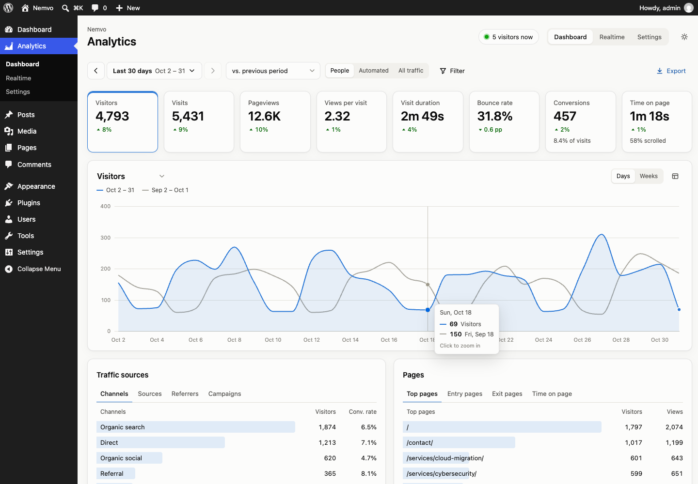

# Nemvo Analytics

Self-hosted, cookieless web analytics for WordPress, with company identification and bot detection. Statistics are stored in your own database, and nothing is sent to third parties.



## What it does

- **The usual reports.** Visitors, visits, pageviews, duration, bounce rate, time on page, scroll depth and conversions, compared with the previous period or the same period last year. You also get traffic sources and UTM campaigns, top, entry and exit pages, page journeys, a world map, devices, a weekday × hour heatmap, goals and events.
- **Who visits.** Every visit's network is looked up locally. Organisations with their own network are named. On internet-provider networks, reverse DNS tells an office line (`fw.acme.se` → *acme.se*) from a home line, so you can see when a prospect's office reads your pricing page.
- **People and bots, separated.** Nothing is blocked. Every visit gets a bot score from request, network, browser and behaviour signals, plus an optional proof of work: built in, or a self-hosted [Cap](https://capjs.js.org) server. The dashboard shows people by default and can switch to automated traffic, listing what was filtered out and why.
- **Drill down anywhere.** Every chart point, map country, heatmap cell and table row filters the whole dashboard. The visit log opens single visits with their pages, time on each page, events and classification.
- **Private by design.** No cookies, no local storage and no fingerprinting. Visitors are counted with a daily-salted hash, and IP addresses and hostnames are never stored.
- **Fast.** The tracker is about 3 KB gzipped and printed inline. A hit is a handful of small queries in one transaction, written after the response has been sent. An optional Valkey queue writes batches of hundreds.

## Requirements

WordPress 6.2 or later and PHP 7.4 or later, with MySQL 5.7+ or MariaDB 10.4+. Optional: Valkey or Redis for the queue, a Cap server, and a separate MySQL/MariaDB database for statistics.

Nemvo Analytics is built for sites **without page caching or a CDN in front**. It works with them, but JavaScript optimizers can delay the tracker and proxies hide visitor addresses. The setup checklist and Site Health warn about both.

## Install

Download `nemvo-analytics-x.y.z.zip` from [Releases](https://github.com/fpoller/nemvo-analytics/releases) and upload it under **Plugins › Add New › Upload Plugin**. Statistics are collected as soon as the plugin is active. Then open **Analytics › Settings**: its setup checklist shows what is worth doing next, such as downloading the free IP databases (countries, and networks for company identification) or adding goals.

## Configuration

Everything can be set on the settings page. Connections can also come from `wp-config.php` constants or environment variables, which win over the settings page. Each of these also accepts a `_FILE` variant pointing at a file, for Docker secrets.

| Variable | Purpose |
|---|---|
| `NEMVO_ANALYTICS_DB_HOST`, `_NAME`, `_USER`, `_PASSWORD`, `_PREFIX` | External statistics database |
| `NEMVO_ANALYTICS_STORAGE` | `local` or `external`: where a new installation starts. After that, **Move statistics** on the settings page decides. |
| `NEMVO_ANALYTICS_QUEUE_URL` | `redis://[:password@]host[:port][/db]` turns the queue on |
| `NEMVO_ANALYTICS_QUEUE_PREFIX` | Key prefix (default `nemvo:`) |
| `NEMVO_ANALYTICS_CAP_URL`, `_SITE_KEY`, `_SECRET`, `_PUBLIC_URL` | Cap server |

### Everything with Docker Compose

```yaml
x-wordpress-env: &wordpress-env
  WORDPRESS_DB_HOST: db
  WORDPRESS_DB_USER: wordpress
  WORDPRESS_DB_PASSWORD_FILE: /run/secrets/db_password
  WORDPRESS_DB_NAME: wordpress
  NEMVO_ANALYTICS_DB_HOST: statsdb
  NEMVO_ANALYTICS_DB_NAME: analytics
  NEMVO_ANALYTICS_DB_USER: analytics
  NEMVO_ANALYTICS_DB_PASSWORD_FILE: /run/secrets/analytics_db_password
  NEMVO_ANALYTICS_QUEUE_URL: redis://valkey:6379/0
  NEMVO_ANALYTICS_CAP_URL: http://cap:3000
  NEMVO_ANALYTICS_CAP_SITE_KEY: your-site-key
  NEMVO_ANALYTICS_CAP_SECRET_FILE: /run/secrets/cap_secret

services:
  wordpress:
    image: wordpress:php8.3-apache
    environment: *wordpress-env
    volumes: [wordpress:/var/www/html]
    secrets: [db_password, analytics_db_password, cap_secret]

  analytics-worker:              # writes queued hits in batches
    image: wordpress:cli-php8.3
    user: "33:33"
    command: wp nemvo-analytics queue work --loop
    environment: *wordpress-env
    volumes: [wordpress:/var/www/html]
    secrets: [db_password, analytics_db_password, cap_secret]

  db:                            # WordPress
    image: mariadb:11.4
    # ...

  statsdb:                       # statistics
    image: mariadb:11.4
    environment:
      MARIADB_DATABASE: analytics
      MARIADB_USER: analytics
      MARIADB_PASSWORD_FILE: /run/secrets/analytics_db_password
      MARIADB_RANDOM_ROOT_PASSWORD: "1"
    secrets: [analytics_db_password]
    volumes: [statsdb:/var/lib/mysql]

  valkey:                        # queue (db 0) and Cap (db 1)
    image: valkey/valkey:9-alpine
    command: valkey-server --save "" --appendonly no --maxmemory 128mb --maxmemory-policy noeviction

  cap:
    image: tiago2/cap:latest
    environment:
      ADMIN_KEY: ${CAP_ADMIN_KEY}
      REDIS_URL: redis://valkey:6379/1
    ports: ["127.0.0.1:3000:3000"] # dashboard, server only

secrets:
  db_password: { file: ./secrets/db_password.txt }
  analytics_db_password: { file: ./secrets/analytics_db_password.txt }
  cap_secret: { file: ./secrets/cap_secret.txt }

volumes:
  wordpress:
  statsdb:
```

Each piece is optional: leave out the services and variables you don't need. The settings page has a step-by-step version of each.

## How it works

```
browser ── tracker.js (inline, ~3 KB) ──► POST /wp-json/nemvo/v1/e
                                             │  validate, attribute source, parse device,
                                             │  locate (IP database or time zone), network + company,
                                             │  bot signals; the IP stays in memory only
                                             ▼
                          ┌──── queue on? ── Valkey list ── worker (batches of 500) ──┐
                          │                                                           ▼
                          └──── no ─────────────────────────────────────────► Processor
                                                                   one transaction per batch:
                                                                   sessions, pageviews, events
```

- **Visitors** are a SHA-256 hash of a rotating secret salt, the site, the IP address and the user agent. The salt changes daily by default, so a visitor is only recognised within one day.
- **Sessions** end after 30 minutes without activity. A single-page visit counts as engaged (not a bounce) after 10 seconds of attention, an event, or a second page.
- **Engaged time** only counts while the tab is visible and the visitor was active in the last five minutes.
- **Networks:** the ASN database gives the network owner. Hosting, education and government networks are recognised by name and number. On ISP networks, a forward-confirmed reverse DNS name separates home, mobile and business lines.
- **Bot score:** the sum of signal weights, from 0 to 100. Visits at or above the threshold (50 by default) count as automated. The settings page lists all signals and their weights.
- **Storage:** WordPress's own database by default, in `{prefix}nemvo_sessions`, `_pageviews` and `_events`. Statistics can be moved to an external MySQL/MariaDB database and back while tracking continues.

## WP-CLI

```sh
wp nemvo-analytics status                     # storage, queue, Cap, IP databases, warnings
wp nemvo-analytics migrate --to=external      # or --to=local
wp nemvo-analytics queue work --loop          # the queue worker
wp nemvo-analytics lookup 203.0.113.7         # location, network and company for an IP
wp nemvo-analytics geoip-update --edition=asn # country | city | asn
wp nemvo-analytics purge --before=2025-01-01
wp nemvo-analytics report --to=you@example.com
wp nemvo-analytics seed --days=90 --reset     # demo traffic, test sites only
```

## Development

The dev container (`.devcontainer/`) runs WordPress, its database, a separate statistics database, Valkey with a queue worker, Cap, Mailpit and Adminer. It sets up demo pages, downloads the free IP databases and seeds 120 days of demo traffic, including automated visits and fictional prospect companies.

```sh
docker compose -f .devcontainer/docker-compose.yml up -d
docker compose -f .devcontainer/docker-compose.yml exec wordpress bash /workspace/.devcontainer/setup.sh
```

| | |
|---|---|
| WordPress | http://localhost:8090 (admin / admin) |
| Mailpit | http://localhost:8095 |
| Adminer | http://localhost:8091 |
| Cap | http://localhost:8092 |

### Tests

```sh
dc="docker compose -f .devcontainer/docker-compose.yml exec -T wordpress"
$dc wp eval-file /workspace/tests/pipeline-test.php   # collection, queue, bot signals, PoW, Cap relay, migration, reports
$dc wp eval-file /workspace/tests/network-test.php    # company/network classification and reverse DNS
cd tests/e2e && npm install && npm test                # real Chrome: tracker, dashboard, settings, migration UI
```

`tests/e2e/screenshots.mjs` regenerates the screenshots, icon and banners in `.wordpress-org/`.

### Build and release

```sh
./build.sh                                     # dist/nemvo-analytics-<version>.zip
./smoke-test.sh dist/nemvo-analytics-1.0.0.zip # clean WordPress + Plugin Check + PHP 7.4 lint
```

`tools/minify-tracker.sh` regenerates the inline copy of the tracker; `build.sh` runs it. See [PUBLISHING.md](PUBLISHING.md) for releases and WordPress.org.

## License

[MIT](nemvo-analytics/LICENSE). Bundled third-party code is listed in [`assets/vendor/README.txt`](nemvo-analytics/assets/vendor/README.txt). IP databases by [DB-IP](https://db-ip.com), CC BY 4.0.
